<div align="center">

# 🏃‍♀️✨ 魔法运动会 Online

**Magical Athlete 非官方在线版：在浏览器里和朋友（或 AI）一起掷骰赛跑。**

36 名运动员各带一个专门「犯规」的技能，比的不是谁跑得快，而是谁更会捣乱。


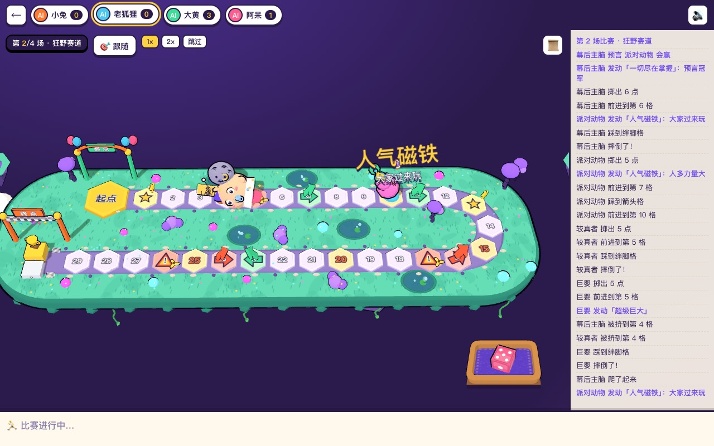

</div>

---

## ✨ 特性

- 🎲 **36 名运动员全部实现**：按官方规则书、2026-08 规则修订和 IELLO FAQ 2.0，连锁触发按规则书顺序结算，带循环保护。
- 🗺️ **四场四种赛道**：温和赛道 → 狂野赛道 → 原创「欢乐嘉年华」（传送门、弹射、陷阱密集）→ 每局重新生成的「随机赛道」。
- 🤖 **AI 补位**：房主可以把空座位设成简单或普通 AI；真人掉线 30 秒后由 AI 托管，回来后交还。
- 🔌 **断线重连**：刷新页面、切换网络、服务端重新部署后，都能自动回到原座位继续玩。
- 👤 **账号与游客**：用户名密码注册；游客一键试玩，只能和 AI 对战。
- 🏝️ **2.5D 赛道**：浮空小岛、36 个程序生成的低多边形棋子（不加载任何模型文件），棋子逐格跳、摔倒、被吃、冲线彩带，技能触发时弹出中文技能名。
- 🎯 **独立骰盘**：骰子在专属托盘里投掷，颜色跟随玩家，落地点数一定等于服务端结果。
- 🔊 **音效和音乐全部由代码合成**：没有音频文件。
- 📱 **手机竖屏可玩**：镜头跟随，可切换全局视角，支持拖动和缩放；设备不支持 WebGL 时自动换成普通网页版赛道。
- 🪶 **体积小**：大厅首屏 JS 约 28 KB gzip，进入对局后合计约 207 KB gzip。

## 📸 截图

| 登录 | 大厅 | 房间（AI 补位） |
|:--:|:--:|:--:|
|  | 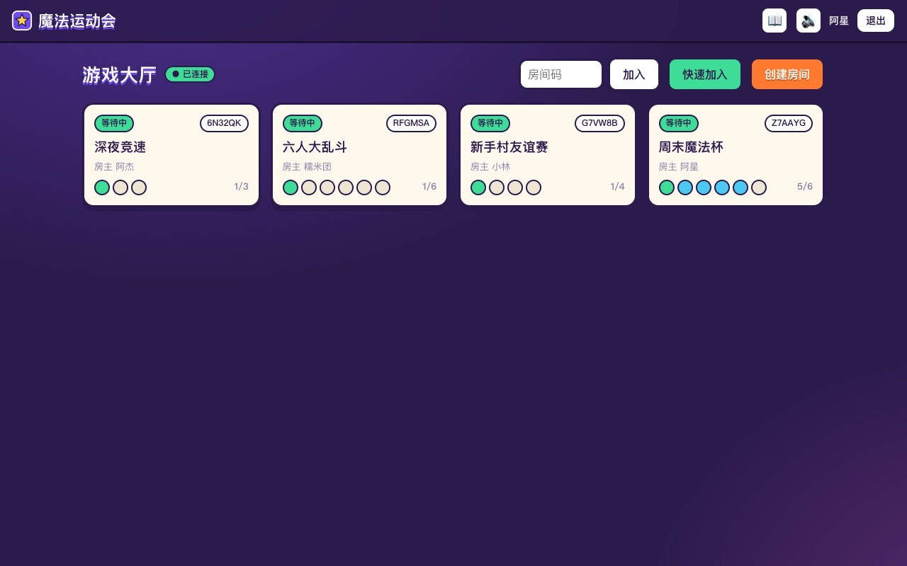 | 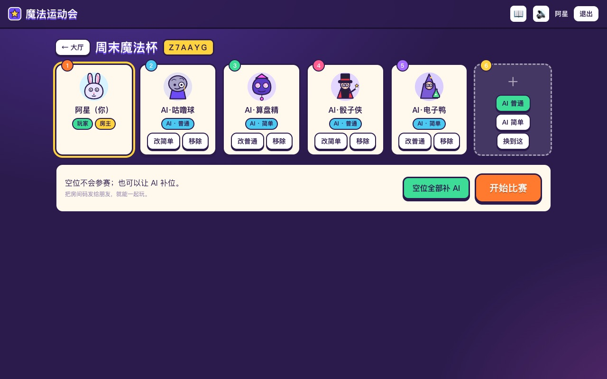 |
| **选秀** | **欢乐嘉年华** | **随机赛道（开场翻牌）** |
| 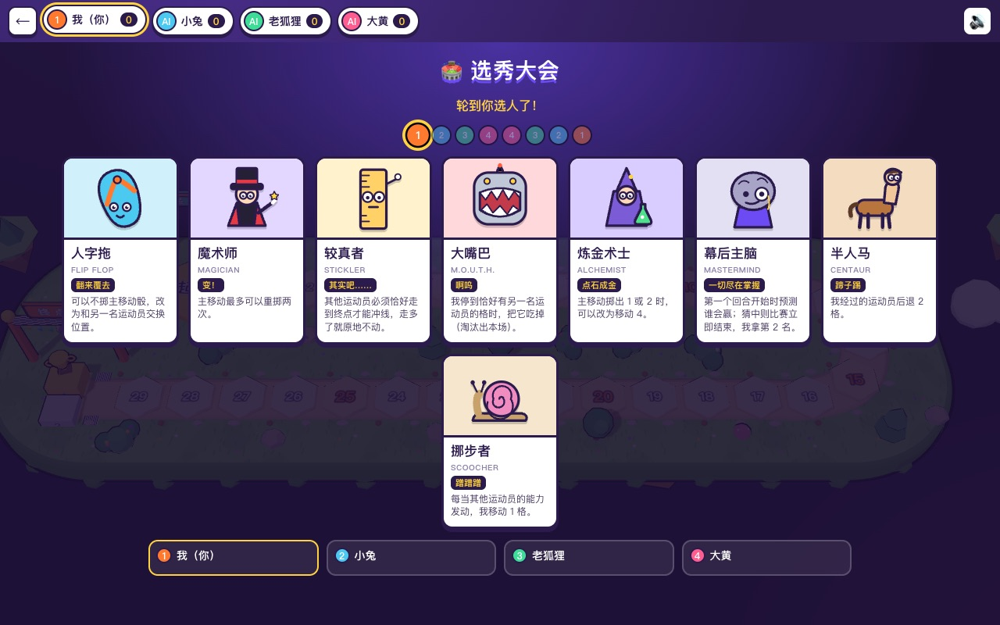 | 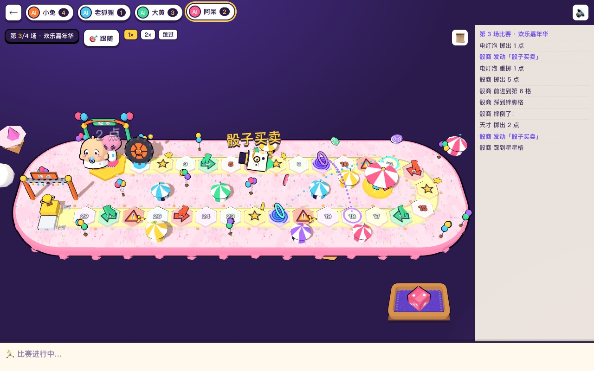 | 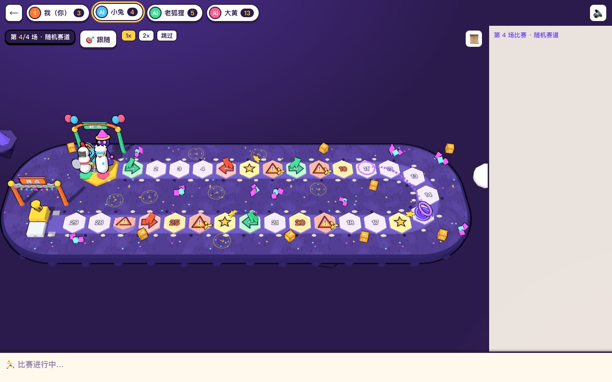 |
| **终局结算** | **角色图鉴** | **手机竖屏** |
| 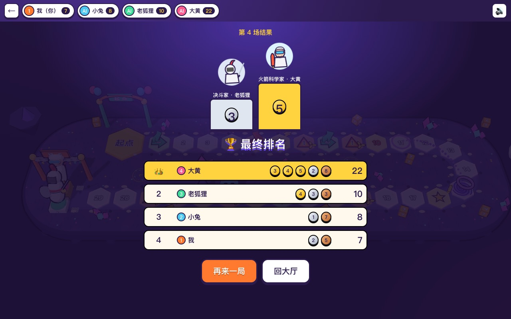 | 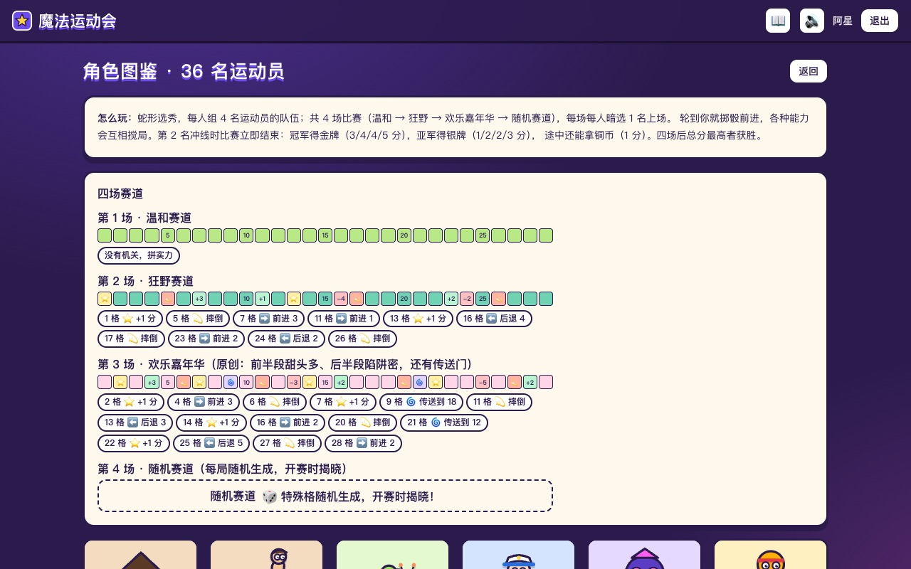 | 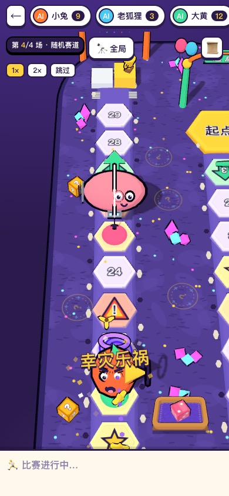 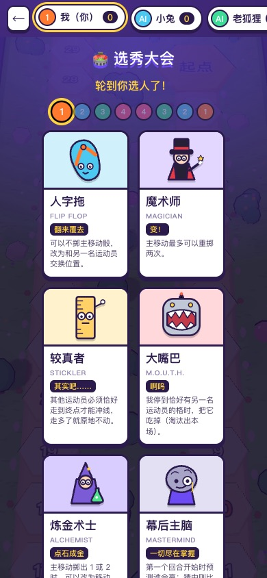 |

## 🎮 玩法速览

1. **选秀**：每轮翻开「人数 × 2」张运动员牌，蛇形轮抽两轮，每人拿到 4 名运动员（2 人局每人 8 名，每场上 2 名）。
2. **派人**：每场所有人从手牌里暗选 1 名，同时亮出。每名运动员整局只上场一次。
3. **比赛**：轮到你时掷骰前进，各种技能随时插一脚。**第 2 名冲线时比赛立即结束。**
4. **计分**：四场的金/银分别是 3/1、4/2、4/2、5/3，另有星格、可爱输家、西西弗斯等铜分。四场后总分最高者获胜。

规则书没写清楚的地方，处理方式都记在 [`docs/rules-decisions.md`](docs/rules-decisions.md)。

## 🚀 部署

只需要一个 Cloudflare 账号，**免费计划即可**（Workers + SQLite 版 Durable Objects + D1）。

```bash
# 1. 安装依赖
npm install

# 2. 登录 Cloudflare
npx wrangler login

# 3. 创建 D1 数据库，把输出里的 database_id 填进 wrangler.jsonc 的 <YOUR_D1_DATABASE_ID>
npx wrangler d1 create magical-athlete-db

# 4. 建表
npm run db:migrate

# 5. 设置会话签名密钥（任意长随机串）
openssl rand -hex 32 | npx wrangler secret put SESSION_SECRET

# 6. 构建并部署
npm run deploy
```

部署完成后访问 `https://magical-athlete.<你的子域>.workers.dev`。

<details>
<summary><b>绑定自定义域名</b></summary>

域名托管在 Cloudflare 的话，在 `wrangler.jsonc` 里加一行（模板里已经留了注释）再部署：

```jsonc
"routes": [{ "pattern": "game.example.com", "custom_domain": true }]
```

也可以复制一份 `wrangler.local.jsonc`（已在 `.gitignore` 中），把私有配置放在里面，用 `npx wrangler deploy -c wrangler.local.jsonc` 部署，避免把域名和数据库 ID 提交到仓库。

</details>

<details>
<summary><b>可调参数（wrangler.jsonc → vars）</b></summary>

| 变量 | 默认值 | 说明 |
|---|---|---|
| `PBKDF2_ITERATIONS` | `20000` | 密码哈希迭代次数。免费计划每次请求 CPU 上限 10 ms，不要设太高 |
| `TURN_TIMEOUT_MS` | `45000` | 真人每次决策的超时，超时后按默认选项处理 |
| `OFFLINE_TAKEOVER_MS` | `30000` | 真人掉线多久后由 AI 托管 |

</details>

### 本地开发

```bash
cp .dev.vars.example .dev.vars    # 填一个随机 SESSION_SECRET
npm run db:migrate:local
npm run build                     # wrangler dev 需要 dist/client
npx wrangler dev --port 8787      # 终端 1：Worker + DO + D1
npm run dev                       # 终端 2：Vite，/api 和 /ws 代理到 8787
```

开发模式下还有几个不需要服务端的调试页面：`#/dev/race`（看 AI 对战）、`#/dev/play?track=carnival`（自己和 AI 在浏览器里打）、`#/dev/pieces`（36 个棋子一览）。

```bash
npm test          # vitest：规则引擎、客户端状态推演、鉴权
npm run sim       # 加速跑几十局 AI 对战，检查能结束、重放一致
```

## 🏗️ 架构

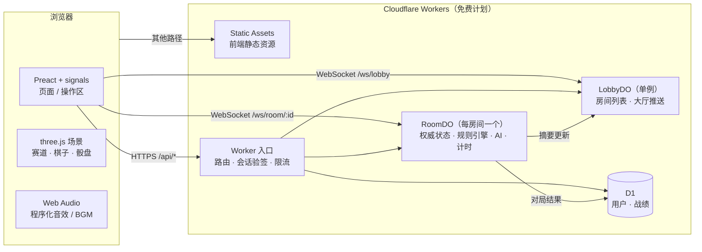

**服务端说了算。** 掷骰、规则结算、AI 决策都在 RoomDO 里跑，客户端只发送「意图」（选牌、掷骰、是否发动技能）。

**规则引擎是纯 TypeScript，可以确定性重放**（[`src/shared/engine.ts`](src/shared/engine.ts)）：

- 整局逻辑写成一个生成器，遇到需要玩家决策的地方就 `yield` 一个 `Request`，拿到 `Answer` 再继续。
- 不用 `Math.random` 和 `Date`，随机数来自带种子的 RNG。相同的种子加相同的回答序列，必然得到相同的局面。
- 所以 RoomDO 只需持久化 **种子 + 回答日志**。每处理完一条消息只追加一行，节省免费额度里最紧张的「行写入」。DO 被回收后重放日志即可恢复。
- 每一步结算输出 `GameEvent[]`（`roll`、`move{path}`、`warp`、`trip`、`power`、`finish`……）。客户端把事件排进队列逐个播放动画，所以画面和规则不会对不上。

**连锁触发**：每次移动或瞬移后收集「后果」（赛道格、经过、停格、决斗……），按「赛道格 → 当前玩家 → 其他玩家顺时针」的优先级排序。每个后果执行前重新检查条件（机会不等人）。循环保护分两层：同一回合内同一触发在完全相同的局面下第二次出现时跳过；单场回合数设上限兜底死局。

**省免费额度**：

- WebSocket 用 Hibernation API，心跳用 `setWebSocketAutoResponse`，空闲时对象不计运行时长。
- 所有计时（行动超时、掉线托管、空房回收）合并成一个 alarm。
- 静态资源走 Static Assets，不计请求数。只有 `/api/*` 和 `/ws/*` 进入 Worker，所以额度用完时页面照样能打开。

### 目录

```
src/
  shared/          前后端共用
    engine.ts        规则引擎（36 名角色、赛道格、连锁结算）
    ai.ts            AI 决策（简单 / 普通）
    characters.ts    角色资料（中文）、四条赛道、随机赛道生成
    types.ts         GameState / Request / Answer / GameEvent
    protocol.ts      HTTP 与 WebSocket 协议
  worker/          Cloudflare Worker
    index.ts         入口与路由
    auth.ts          注册登录、PBKDF2、HMAC 会话 Cookie
    lobby.ts         LobbyDO
    room.ts          RoomDO（对局推进、AI 补位、托管、重连）
  client/          前端
    pages/           登录、大厅、房间、图鉴、声明
    game/            对局视图、事件播放、操作区
    scene/           three.js 赛道、棋子、骰盘、DOM 降级版
    art/             程序化 SVG 头像、调色板、赛道主题
    audio.ts         程序化音效与 BGM
migrations/        D1 表结构
test/              vitest
scripts/           AI 对战模拟、WebSocket 冒烟测试
docs/              调研、计划、规则裁定、截图
```

## 📚 文档

| 文档 | 内容 |
|---|---|
| [`docs/research-rules.md`](docs/research-rules.md) | 规则调研：完整规则、36 名角色能力原文与翻译、FAQ |
| [`docs/research-tracks.md`](docs/research-tracks.md) | 赛道调研：官方赛道与续作赛道 |
| [`docs/rules-decisions.md`](docs/rules-decisions.md) | 规则书没写清楚之处的处理方式 |
| [`docs/research-cloudflare.md`](docs/research-cloudflare.md) | Cloudflare 免费计划的限制与容量估算 |
| [`docs/research-frontend.md`](docs/research-frontend.md) | 前端技术选型、体积实测、素材来源 |
| [`docs/ARCHITECTURE.md`](docs/ARCHITECTURE.md) | 引擎 API、持久化与计时约定 |

## ⚠️ 声明

本项目是**非官方同人作品，仅供个人娱乐，非商业用途**。

《Magical Athlete》的游戏名称、角色名称和规则归原作者 Takashi Ishida、Richard Garfield 及出版商 CMYK 所有。本项目的美术、音效和代码全部原创，没有使用原版游戏的任何美术素材。如果你喜欢这个游戏，请支持正版（中文版《胡闹运动会》）。

如权利方认为本项目有不妥之处，请提 issue 联系，我会及时处理。

## 📄 许可证

代码以 [MIT](LICENSE) 协议开源。上面的声明不在 MIT 授权范围内：游戏本身的知识产权不随本仓库授予。
